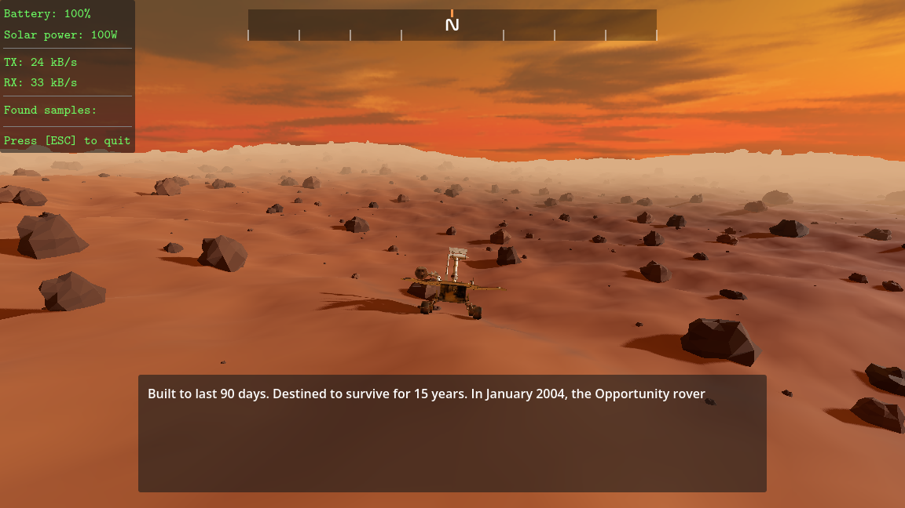

# Space Yard

A short narrative game about NASA's Opportunity rover on Mars, made in Godot 4.7 for the [NASA Space Apps Challenge](https://www.spaceappschallenge.org/).



## About

*Built to last 90 days. Destined to survive for 15 years.*

You drive Opportunity across Meridiani Planum, guided by voiced transmissions from JPL Control. You study the local rocks, find hematite "blueberries", and descend into a crater whose layered bedrock shows that liquid water once flowed here. After the primary mission, a planet-wide dust storm rolls in, and the story ends the way the real mission did.

## Features

- **Endless procedural Mars terrain** with craters and boulders, streamed in chunks around the rover.
- **The MER rover model** with working rocker-bogie suspension: wheels spin and steer, and the rockers and bogies follow the ground.
- **A voiced mission**: JPL transmissions with subtitles. Waypoint beacons show where to go next, and idle chatter plays if you stop for too long.
- **Sample analysis**: at a target, press E to stop and analyze. The sample is added to your telemetry.
- **A dust storm finale**: fog, darkness and blowing dust that grow until the rover can no longer move.
- **HUD**: compass, telemetry panel (battery, power, data link, found samples) and a dialog box.
- **Menus**: main menu, pause menu and a volume setting.

## Controls

| Key | Action |
|---|---|
| W / S | Drive forward / backward |
| A / D | Turn left / right |
| Left mouse + drag | Orbit the camera |
| E | Analyze a sample (at a target, when prompted) |
| Esc | Pause menu |

## Mission

1. Landing and boot sequence.
2. Drive to the glowing beacon at a rock formation and press **E** to analyze it ("Blueberries").
3. Head for the crater and analyze the bedrock on its floor ("Crater soil sample").
4. Primary mission complete, so you are free to explore.
5. The dust storm arrives.

## Running the game

1. Install [Godot 4.7](https://godotengine.org/download/) (standard build, no .NET needed).
2. Open `project.godot` in Godot and press **F5**, or run from the project folder:

   ```sh
   godot --path .
   ```

The game starts at the main menu, and **Play** loads the Mars scene (`scenes/terrain_sandbox.tscn`).

## Running the tests

The tests are headless scripts that print `<name> OK` when they pass:

```sh
timeout -s KILL 60 godot --headless -s tests/test_terrain_generator.gd < /dev/null
```

The other tests are `tests/test_rover.gd`, `tests/test_poi.gd` and `tests/test_mission.gd`. A failed assert makes Godot wait for input, which is why the commands use `timeout` and `< /dev/null`. If a test hangs or exits without `OK`, look for `SCRIPT ERROR` in its output.

## Project structure

```
assets/    audio (voice lines, music), 3D models, fonts, shaders, mission_1.json (all dialog text)
prefabs/   reusable scenes: rover, terrain generator, waypoint beacon, music player
scenes/    main menu, the Mars scene (terrain_sandbox.tscn), options, UI
scripts/   game logic: rover, terrain, camera, mission and events, UI
tests/     headless test scripts
```

- **Dialog text** lives in `assets/mission_1.json`, keyed by transmission name.
- **The mission** is the `Mission` node in `scenes/terrain_sandbox.tscn`. Each child is one event, with its transmission key, voice clip, delay, optional target (POI) and an optional sample to analyze. Events play in tree order, so reordering the nodes reorders the mission.

## Team

- Eryk Kopciuch (lead)
- Dawid Szczędor
- Patryk Przybyło
- Zuzanna Makowiecka
- Sylwester Półtorak
- Kacper Saletnik
